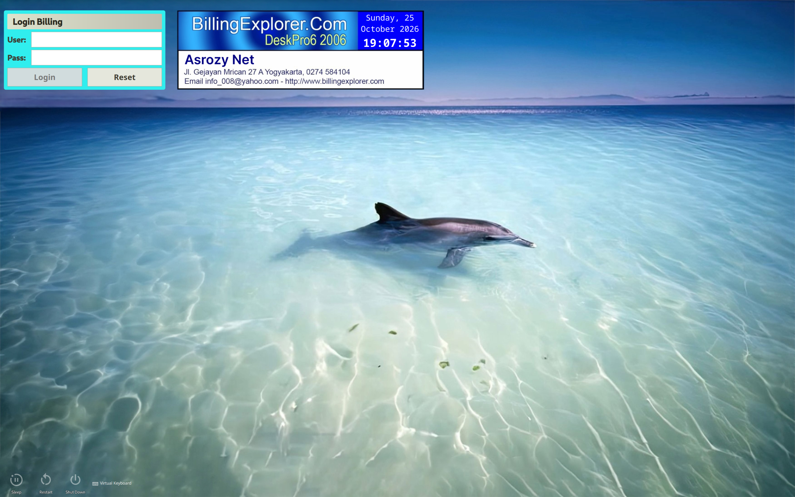

# Dolphin Billing Warnet SDDM Theme

A nostalgic, retro Indonesian warnet (internet cafe) billing styled theme for SDDM (Simple Desktop Display Manager) built for modern systems running KDE Plasma / Qt6 / Qt5.



Developed by **M Faisal Asrozy** ([@asrozy98](https://github.com/asrozy98)), based on the Sweet-Mars-Plasma6 SDDM theme ([GitHub Source](https://github.com/vaxerski/sweet-mars-plasma6)).

## Features

- **Retro Aesthetic**: Recreates the classic layout of Indonesian internet cafe billing clients.
- **Smart PAM Lockout Sync**: Automatically detects and adapts to your OS's PAM configuration (`pam_faillock`) during installation.
- **Dynamic Lockout Countdown**: Prevents brute force login attempts. Upon multiple wrong password entries (default: 3), the login screen locks and displays an interactive countdown dialog showing the remaining wait time.
- **Text Overflow Prevention**: Restricts title text lengths on the login box to prevent visual overflow.
- **Responsive Layout**: Adjusts UI element sizes dynamically depending on screen resolution.

## Installation

### Automatic Installation (Recommended)

1. Clone or download this theme repository.
2. Open your terminal inside the theme directory.
3. Run the installer script with root privileges:
   ```bash
   sudo ./install.sh
   ```
   _The installer script will copy the files to `/usr/share/sddm/themes/` and automatically scan your system's `/etc/security/faillock.conf` to set the correct lockout parameters (maximum attempts and lockout duration) in the configuration._

### Manual Installation

1. Copy the `Billing-Warnet` folder to your SDDM themes directory:
   ```bash
   sudo cp -r Billing-Warnet /usr/share/sddm/themes/
   ```
2. (Optional) Open `/usr/share/sddm/themes/Billing-Warnet/theme.conf` and configure the lockout settings manually to match your PAM settings:
   ```ini
   [General]
   # ...
   lockoutAttempts=3     # Max failed attempts before locking
   lockoutDuration=600   # Lockout duration in seconds (default: match OS)
   ```

## Activating the Theme

After installation, activate the theme using one of the following methods:

### Via KDE System Settings

1. Go to **System Settings** -> **Colors & Themes** -> **Login Screen (SDDM)**.
2. Select **Dolphin Billing Warnet** from the theme list.
3. Click **Apply**.

### Via SDDM Configuration File

Edit `/etc/sddm.conf` (or your active config file inside `/etc/sddm.conf.d/`) and set the theme in the `[Theme]` section:

```ini
[Theme]
Current=Billing-Warnet
```

---

_Created with nostalgia and care by M Faisal Asrozy_
